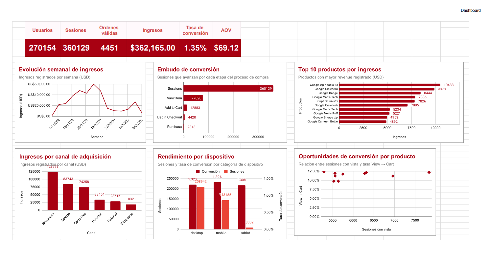

# E-commerce Marketing Analytics

Proyecto de análisis de marketing y conversión enfocado en comprender el comportamiento de los usuarios dentro de un e-commerce, identificar los principales canales de adquisición, analizar el recorrido de compra y detectar oportunidades de optimización.

El análisis utiliza datos públicos de **Google Analytics 4** correspondientes a **Google Merchandise Store** y fue desarrollado principalmente con **BigQuery, SQL y Google Sheets**.

---

## Problema de negocio

El equipo de marketing necesita comprender:

- cómo interactúan los usuarios con el e-commerce;
- cuáles son las principales fuentes de adquisición;
- dónde ocurren las mayores pérdidas durante el proceso de compra;
- cómo cambia el desempeño por dispositivo;
- qué productos generan mayor valor o presentan oportunidades;
- cómo evolucionó el negocio durante el periodo analizado.

El objetivo es transformar datos de comportamiento y ventas en información útil para apoyar decisiones de marketing y optimización de conversión.

---

## Dataset

**Fuente:** Google Analytics 4 Sample E-commerce Dataset  
**Negocio:** Google Merchandise Store  
**Periodo:** 1 de noviembre de 2020 – 31 de enero de 2021  
**Días analizados:** 92

| Métrica | Resultado |
|---|---:|
| Eventos | 4,295,584 |
| Usuarios únicos | 270,154 |
| Sesiones | 360,129 |

---

## Herramientas

| Herramienta | Uso |
|---|---|
| Google Analytics 4 Sample Dataset | Fuente de datos |
| BigQuery | Consulta y procesamiento |
| SQL | KPIs, validaciones, funnels y segmentación |
| Google Sheets | Connected Sheets y dashboard |
| Canva | Presentación ejecutiva |
| GitHub | Documentación y publicación |

---

## Metodología

### 1. Exploración del dataset

Se revisaron los principales eventos de GA4 y conceptos fundamentales como usuario, sesión, evento y orden.

### 2. Construcción de sesiones

Las sesiones se identificaron mediante la combinación única de **user_pseudo_id + ga_session_id**, lo que permitió identificar **360,129 sesiones**.

### 3. Validación de compras

| Validación | Resultado |
|---|---:|
| Eventos purchase | 5,692 |
| IDs nulos | 23 |
| (not set) | 883 |
| IDs inválidos | 906 |
| Transaction IDs válidos únicos | 4,451 |

Por esta razón, las órdenes se definieron utilizando transaction_id válidos, únicos y deduplicados.

### 4. Análisis

Se desarrollaron análisis de KPIs ejecutivos, funnel secuencial, adquisición, dispositivos, productos, segmentación mediante cuartiles y tendencias temporales.

---

## KPIs principales

| KPI | Resultado |
|---|---:|
| Usuarios | 270,154 |
| Sesiones | 360,129 |
| Sesiones con compra | 4,848 |
| Órdenes válidas | 4,451 |
| Ingresos registrados | $362,165 USD |
| Revenue de órdenes válidas | $307,640 USD |
| Tasa de conversión | 1.35% |
| AOV deduplicado | $69.12 USD |

> **Nota:** los ingresos registrados corresponden al revenue observado en eventos purchase. El AOV se calcula utilizando órdenes con transaction_id válido y deduplicado.

---

## Principales hallazgos

### Adquisición

La **búsqueda orgánica** fue la principal fuente de adquisición por volumen de usuarios, sesiones e ingresos.

| Canal | Usuarios | Sesiones | Ingresos |
|---|---:|---:|---:|
| Búsqueda orgánica | 101,742 | 134,119 | $123,773 |
| Directo | 64,109 | 85,643 | $83,743 |
| Otros / No identificado | 50,001 | 67,198 | $74,258 |
| Referral | 25,257 | 33,880 | $33,454 |
| Referral interno | 14,763 | 20,567 | $28,616 |
| Búsqueda pagada | 14,282 | 18,722 | $18,321 |

El canal con mayor volumen no necesariamente presenta la mayor eficiencia.

### Funnel de conversión

| Etapa | Sesiones |
|---|---:|
| Sessions | 360,129 |
| View Item | 77,020 |
| Add to Cart | 12,883 |
| Begin Checkout | 4,420 |
| Purchase | 2,313 |

La mayor pérdida ocurre antes del carrito: solo **16.73%** de las sesiones con vista de producto avanzan a Add to Cart.

### Dispositivos

Desktop concentra la mayor parte del tráfico y los ingresos, pero **Mobile presenta una tasa de conversión ligeramente superior**.

| Dispositivo | Sesiones | Conversión |
|---|---:|---:|
| Desktop | 208,942 | 1.32% |
| Mobile | 143,185 | 1.39% |
| Tablet | 8,002 | 1.30% |

### Productos

- **Google Zip Hoodie F/C** fue uno de los productos con mayor revenue.
- **Super G Unisex Joggers** destacó por volumen e interés.
- **Google Utility Backpack** fue identificado como una oportunidad de conversión por combinar alta visibilidad con un menor avance hacia el carrito.

### Tendencia temporal

Diciembre presentó el mejor desempeño general en volumen, ingresos y conversión.

La semana iniciada el **7 de diciembre de 2020** registró:

- 38,729 sesiones;
- 772 sesiones con compra;
- $59,865 de revenue;
- 1.99% de conversión.

Posteriormente se observó una desaceleración importante durante la segunda mitad de diciembre.

---

## Recomendaciones

1. **Optimizar View → Cart:** revisar propuesta de valor, precio, imágenes, descripción, CTA, promociones y disponibilidad.
2. **Priorizar productos con oportunidad de conversión:** investigar productos con alta visibilidad y bajo avance al carrito.
3. **Mantener atención en Mobile:** no asumir que desktop es superior; Mobile convirtió ligeramente mejor.
4. **Aprovechar el posicionamiento orgánico:** profundizar en SEO, landing pages, contenido y keywords.
5. **Analizar campañas de temporada:** utilizar el pico de principios de diciembre como referencia, sin asumir causalidad.

---

## Limitaciones

- Dataset ofuscado.
- Presencia de valores <Other> y (data deleted).
- Eventos de compra sin transaction_id válido.
- Reutilización de algunos IDs.
- No todos los eventos view_item y begin_checkout contienen información de items.
- No existe información de inversión publicitaria.
- No es posible calcular ROAS o CPA.
- El análisis no demuestra causalidad detrás de los abandonos.
- La atribución utilizada corresponde principalmente a adquisición inicial del usuario.

---

## SQL

Las consultas principales se encuentran en la carpeta [sql/](sql/):

1. [01_executive_kpis.sql](sql/01_executive_kpis.sql)
2. [02_conversion_funnel.sql](sql/02_conversion_funnel.sql)
3. [03_acquisition_performance.sql](sql/03_acquisition_performance.sql)
4. [04_device_performance.sql](sql/04_device_performance.sql)
5. [05_product_performance.sql](sql/05_product_performance.sql)
6. [06_monthly_performance.sql](sql/06_monthly_performance.sql)
7. [07_weekly_performance.sql](sql/07_weekly_performance.sql)

---

## Dashboard

El dashboard final fue desarrollado en Google Sheets e incluye KPIs, evolución semanal, funnel, adquisición, dispositivos y análisis de productos.

---

## Presentación

[**Ver presentación del proyecto**](presentation/ecommerce_marketing_analysis.pdf)

---

## Estructura del repositorio

~~~text
ecommerce-marketing-analytics/
│
├── README.md
├── sql/
│   ├── 01_executive_kpis.sql
│   ├── 02_conversion_funnel.sql
│   ├── 03_acquisition_performance.sql
│   ├── 04_device_performance.sql
│   ├── 05_product_performance.sql
│   ├── 06_monthly_performance.sql
│   └── 07_weekly_performance.sql
├── dashboard/
│   └── ecommerce_marketing_dashboard.png
└── presentation/
    └── ecommerce_marketing_analysis.pdf
~~~

---

## Conclusión

El análisis permitió transformar más de **4.2 millones de eventos de GA4** en información accionable sobre adquisición, conversión, dispositivos, productos y comportamiento temporal.

Los resultados muestran que generar tráfico no es suficiente: la eficiencia del funnel, la calidad del canal y el comportamiento del producto son fundamentales para comprender el rendimiento real del e-commerce.

---

**Thelma Poot Diosdado**  
Proyecto de portafolio — Data Analytics
